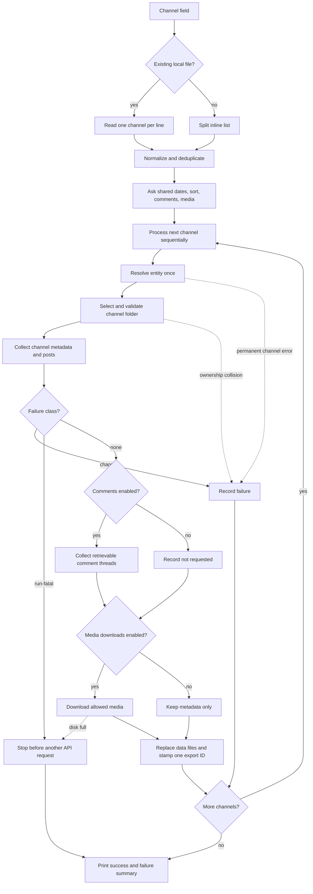

# Telegram Export Expansion - Plan

## Goal Capsule

### Current implementation status (2026-08-26)

- **Implemented and locally verified:** U1–U4 are present in `telegram_stats_bot.py`; `/usr/bin/python3 -m unittest -v` passes 16 fake-client tests without a network connection.
- **Still external:** the authenticated compact/enriched smoke checks and repeat-run validation against live Telegram need an authorized account and suitable accessible channels. They have not been represented as complete.
- **Current contracts:** operational use is documented in [`README.md`](../../README.md); the versioned output schema is [`docs/output-contract.md`](../output-contract.md).

- **Objective:** Produce analysis-ready Telegram channel exports that preserve channel, post, comment, and media context for one or many channels without unnecessary token overhead.
- **Means:** Extend the existing interactive Telethon exporter with per-channel folders, fixed CSV schemas, compact JSONL comments, optional media downloads, and one shared batch pipeline (KTD1-KTD5).
- **Authority:** Confirmed requirements and session-settled decisions in the Product Contract override implementation preferences; current Telethon 1.43.2 behavior constrains API handling.
- **Execution profile:** Standard code plan. Add characterization coverage before changing the legacy single-file flow.
- **Stop conditions:** Stop if Telethon 1.43.2 cannot expose a required field, a resolved output path can escape `OUTPUT_DIR`, or a folder collision would overwrite another channel.
- **Tail ownership:** Implementation includes tests and authenticated smoke verification; no deployment or external publication is required.

---

## Product Contract

### Summary

The exporter will create a self-contained folder for each resolved channel, write compact analysis files, and optionally include comments and media files. Single-channel and batch runs will use the same date range, sort choice, and export options.

### Problem Frame

The current exporter accepts one channel, collects a limited post schema, and writes one indented JSON file. It omits channel description and subscriber count, comment data, media metadata, media files, and batch input. Repeated JSON keys also add avoidable context overhead when agents analyze large flat post collections.

### Key Decisions

- **Use CSV for flat channel and post data and compact JSONL for comments.** Governs R8. (session-settled: user-approved — chosen over JSON-only export: CSV removes repeated flat-field keys while JSONL preserves an extensible comment record.)
- **Batch files are local paths only.** Governs R1. (session-settled: user-directed — chosen over remote file URLs: the user confirmed local input.)
- **Downloaded media lives in a `media` child folder of its channel.** Governs R7. (session-settled: user-directed — chosen over placing media beside data files: the user specified `output/<channel>/media/`.)
- **A channel without a username uses its title as the folder name.** Governs R3. (session-settled: user-directed — chosen over rejecting the channel or using `channel_<id>`: the user requested the channel name.)

### Requirements

**Input and run scope**

- R1. The channel field accepts one channel, comma or whitespace separated channels, or an existing local UTF-8 text file with one channel per line; normalization removes blanks and preserves the first occurrence.
- R2. Start and end dates accept exact valid `YYYY-MM-DD`, `YYYY.MM.DD`, and `YYYY/MM/DD` values while retaining the current UTC day-boundary and reversed-range validation.
- R3. Each resolved channel writes to `OUTPUT_DIR/<username>/`; when username is absent, it writes to a filesystem-safe form of the channel title and refuses a collision with another channel ID.
- R4. Batch runs ask for dates, sort, comment export, and media download once and apply those run-level choices to every channel.
- R5. A permanent resolution or permission error affects only its channel, while the run ends with successful and failed channel summaries.

**Exported data**

- R6. `channel.csv` contains a stable one-row schema with channel ID, title, username, description, subscriber count, channel type and flags, creation time, linked discussion ID, requested period, and export time; unavailable values remain empty rather than becoming zero.
- R7. `posts.csv` retains the current post fields and adds channel ID, comment count, comment availability and export status, discussion ID, and flattened media metadata.
- R8. `comments.jsonl` starts with one run-control record and, when comment export is enabled, continues with every retrievable comment for each selected post, including explicit source-post, discussion-thread, sender, reply, text, date, and media linkage.
- R9. Media metadata is always present for posts and exported comments; when download is enabled, files are stored under `OUTPUT_DIR/<channel-folder>/media/` and records contain paths relative to the channel folder.
- R10. Flat channel and post records use deterministic UTF-8 CSV columns; the comment stream uses one compact UTF-8 JSON object per line with no indentation or blank records.

**Integrity and compatibility**

- R11. Telegram's server-side comment count is preserved independently from the number of comments successfully exported.
- R12. Each output file is atomically replaced, every current data file carries one shared `export_id`, and repeat runs do not append duplicate rows or create duplicate media filenames.
- R13. Media-only posts remain eligible for export, protected media is not downloaded, and a failed download leaves its metadata and an explicit status intact.
- R14. The existing sort choices and single-channel input forms remain supported.
- R15. The exporter resolves only channels already accessible to the authenticated account and never joins a channel automatically.

### Key Flows

- F1. Single-channel export
  - **Trigger:** The user enters one channel reference.
  - **Steps:** Parse run settings, resolve the entity once, select its folder, collect records, publish files atomically, and report the outcome.
  - **Covered by:** R2-R14
- F2. Batch export
  - **Trigger:** The user enters an inline list or a local list-file path.
  - **Steps:** Normalize and deduplicate inputs, collect shared run settings once, process channels sequentially through F1, and report all outcomes.
  - **Covered by:** R1-R5, R12
- F3. Optional enrichment
  - **Trigger:** The user enables comments, media downloads, or both.
  - **Steps:** Preserve server counts, export retrievable comment threads, download allowed files, record partial failures, and publish the current run's references.
  - **Covered by:** R7-R13

### Acceptance Examples

- AE1. Covers R1-R5. Given a local file containing blank lines, repeated aliases, and two valid channels, the run asks for common settings once and exports each resolved channel no more than once.
- AE2. Covers R3. Given an accessible private channel without a username, the exporter uses its sanitized title and stops that channel instead of overwriting a folder already owned by another channel ID.
- AE3. Covers R8 and R11. Given a post that advertises ten comments while eight are retrievable, `posts.csv` keeps `comments_count=10`, records eight exported rows, and marks the export as partial rather than rewriting the count.
- AE4. Covers R9 and R13. Given a media-only protected post with downloads enabled, the post remains in `posts.csv`, its media metadata is present, and no file is saved.
- AE5. Covers R5 and R12. Given one unavailable channel between two valid channels, the valid channels complete, the failed channel is listed once, and prior complete outputs are not replaced by partial files.

### Scope Boundaries

In scope: the interactive CLI in `telegram_stats_bot.py`, its output contract, and one focused stdlib test file.

#### Deferred to Follow-Up Work

- Remote URL loading for channel lists.
- A database, graphical interface, scheduled jobs, or parallel channel processing.
- Telethon takeout sessions and resumable checkpoints; add them only if real large exports hit limits that the sequential flow cannot absorb.
- Migration to Telethon v2 while it remains an incompatible alpha line.

---

## Planning Contract

### Key Technical Decisions

- KTD1. **Use one sequential per-channel pipeline with bounded enrichment.** Parse run-level input once, reuse one authenticated client, and resolve each entity once. Keep sortable post records in memory, stream comments to their temporary JSONL file, and download one media item at a time.
- KTD2. **Use explicit schemas and composite identifiers.** Treat `(channel_id, post_id)` and `(discussion_chat_id, comment_id)` as stable keys; usernames and titles are labels that may change. CSV media columns cover common fields, while one compact extra JSON value carries uncommon media-specific attributes.
- KTD3. **Publish deterministic files with detectable generations.** Replace each data file from a temporary sibling and stamp `channel.csv`, every post row, and the first JSONL run-control record with one `export_id`. A reader rejects mismatched generations; media downloads use temporary files and deterministic message-namespace names.
- KTD4. **Use Telethon 1.43.2 public v1 contracts with one flood-wait policy.** Read extended channel data through `channels.GetFullChannelRequest`, server comment counts through `Message.replies`, comments through `iter_messages(..., reply_to=...)`, and media through `Message.file` plus `download_media`. Telethon may absorb waits within its configured threshold; a longer wait aborts the run before another Telegram request and preserves completed channel outputs.
- KTD5. **Keep the implementation stdlib-first and importable.** Reuse `parse_media_info()` from `export_marketing_chat.py`, use `csv`, `json`, `tempfile`, and `os`, and move environment validation into the runtime path so pure helpers can be unit tested without process exit.
- KTD6. **Select the folder from the resolved entity and fail closed on ambiguous ownership.** Use username when available and otherwise a sanitized title. Allow an empty new folder; for a non-empty folder, treat `channel.csv` as the identity authority and reject missing, invalid, or mismatched channel ID. (session-settled: user-directed — chosen over rejecting username-less channels or using an ID-only fallback: the user requested the channel name; governs R3.)

### High-Level Technical Design

### Sequencing and Implementation Constraints

- Add pure parsing and serialization seams before changing the async collection loop.
- Preserve the user's existing uncommitted environment-validation, type-hint, filename-sanitization, and Telethon 1.43.2 changes in `telegram_stats_bot.py` and `requirements.txt`.
- Use Telegram's advertised comment count as source data. Never infer it from exported JSONL length.
- Export all retrievable comments for posts selected by the post date range; do not apply the post date range again to comment dates.
- A `FloodWaitError` above Telethon's configured threshold aborts the sequential run before another request. Rerunning the batch is a retry, not a checkpoint resume.

### Risks & Dependencies

- **Comment count divergence:** Deleted, inaccessible, channel-authored, or concurrently added replies can make exported rows differ from Telegram's count. Preserve both values and an export status.
- **Folder collision:** Different username-less channels can share a title. Validate the stored channel ID and fail safely instead of overwriting.
- **Rate limits:** Comments and media multiply requests. Rely on Telethon's retry/flood-wait behavior and explicit long-wait handling rather than the current fixed `0.01` second sleep.
- **Memory growth:** Post sorting requires the selected post records, but comment text and media bytes must not accumulate in memory. Stream comments to a temporary JSONL file and media to one temporary file at a time.
- **Request growth:** Each channel performs one resolution, one full-channel fetch, one post traversal, comment traversal only for posts advertising replies, and at most one download per eligible media record. Counting fakes must detect duplicate calls.
- **Disk growth:** Repeat runs retain media no longer referenced by the current range. Current CSV/JSONL references define the active export; cleanup remains deferred because automatic deletion risks data loss. `ENOSPC` is run-fatal, removes incomplete temporary files, and prevents later channel requests.
- **Version drift:** The project pins Telethon 1.43.2 while current stable documentation may describe 1.44. Lock required behavior with fakes and one authenticated smoke run.

### Sources & Research

- Current flow and output contract: `telegram_stats_bot.py`.
- Existing media serialization and atomic replacement patterns: `export_marketing_chat.py`.
- Existing CSV writer pattern: `get_subscribers.py`.
- Existing paired export sample: `output/telegram_stats_parfumberry_smr_20240101_20260323.json` is 1,096,878 bytes and its CSV counterpart is 934,832 bytes. This is about 15% smaller by bytes; exact token savings remain tokenizer-dependent.
- [Telethon client API: message iteration, downloads, retries, and flood waits](https://docs.telethon.dev/en/stable/modules/client.html)
- [Telegram `channelFull` fields](https://core.telegram.org/constructor/channelFull)
- [Telegram `MessageReplies`](https://core.telegram.org/constructor/messageReplies)
- [Telegram discussion groups and comment threads](https://core.telegram.org/api/discussion)
- [Python `csv` documentation](https://docs.python.org/3/library/csv.html)
- [Python `json` documentation](https://docs.python.org/3/library/json.html)

---

## Implementation Units

### U1. Normalize run input and make helpers testable

- **Goal:** Make single and batch input share pure parsing, date, option, and configuration boundaries.
- **Requirements:** R1, R2, R4, R14
- **Dependencies:** None
- **Files:** `telegram_stats_bot.py`, `test_telegram_stats_bot.py`
- **Approach:**
  1. Move environment validation from import time into the runtime entry path without changing the existing validation behavior.
  2. Add one channel-source parser that checks the complete quoted value as a local path before splitting inline comma or whitespace input.
  3. Normalize each item through the existing channel parser, preserve order, and deduplicate normalized values.
  4. Add one exact date parser shared by the start and end prompts, then gather sort and optional enrichment choices once per run.
- **Patterns to follow:** Existing prompt helpers and `parse_channel_input()` in `telegram_stats_bot.py`.
- **Execution note:** Start with characterization tests for current single-channel and date behavior, then add the new accepted forms.
- **Test scenarios:**
  - Covers AE1. A UTF-8 local file with blank lines and duplicate channels returns the first occurrence of each normalized channel in order.
  - Inline comma, spaces, tabs, `@name`, and `https://t.me/name` inputs normalize into the same ordered list.
  - A quoted existing path containing spaces is read as one path; a missing path-like value returns a file error rather than channel fragments.
  - Each supported date separator produces the same UTC date, while mixed separators, impossible dates, and an end before start are rejected.
  - Importing the module with no Telegram environment variables does not exit; starting the CLI still reports missing or non-integer `API_ID`.
- **Verification:** Pure helpers are deterministic and the current single-channel forms remain accepted.

### U2. Define compact, atomic per-channel outputs

- **Goal:** Produce stable channel, post, and comment files without partial publication or duplicate rows.
- **Requirements:** R3, R6-R12
- **Dependencies:** U1
- **Files:** `telegram_stats_bot.py`, `test_telegram_stats_bot.py`
- **Approach:**
  1. Select the folder through KTD6 and verify ownership with the resolved channel ID before overwriting existing data.
  2. Define fixed `channel.csv` and `posts.csv` column orders, plus the compact comment record owned by R8 and KTD2.
  3. Write each table or JSONL stream to a temporary sibling with the run's shared `export_id` and replace the final file only after successful close.
  4. Replace the current indented JSON output with the new files; always publish `comments.jsonl` with a run-control record so a disabled export cannot expose stale comments as current data.
- **Patterns to follow:** `csv.DictWriter` usage in `get_subscribers.py` and `save_backup_atomic()` in `export_marketing_chat.py`.
- **Test scenarios:**
  - Covers AE2. A username uses `output/<username>/`; a missing username uses a sanitized title; traversal characters cannot escape `OUTPUT_DIR`.
  - Two different channel IDs resolving to the same sanitized title produce a safe collision error and do not replace either channel's files.
  - CSV round-trips commas, quotes, emoji, and multiline post text with one header and no extra blank records.
  - Every JSONL line parses independently, uses compact UTF-8 JSON, and the file ends with a newline; the first record identifies the run and whether comments were requested.
  - Two identical writes keep the same row counts and file names.
  - Data files with different `export_id` values are detected as a mixed generation rather than treated as one complete export.
  - A non-empty title fallback folder with missing, invalid, or mismatched `channel.csv` identity fails closed.
  - An injected failure before `os.replace` leaves the previous complete target unchanged and exposes no temporary file as final output.
- **Verification:** A reader can join records by composite IDs and distinguish current complete output from a failed attempt.

### U3. Collect full Telegram metadata, comments, and media

- **Goal:** Enrich each selected post and channel through pinned Telethon v1 contracts while preserving partial-result semantics.
- **Requirements:** R6-R9, R11, R13, R15
- **Dependencies:** U2
- **Files:** `telegram_stats_bot.py`, `test_telegram_stats_bot.py`
- **Approach:**
  1. Resolve the entity once and fetch extended channel metadata once through KTD4.
  2. Keep text or media posts in the date range, preserve existing engagement fields, and add server comment and media fields.
  3. When comments are enabled, stream each selected post's thread into the temporary JSONL file and serialize comment, reply, sender, thread, and media linkage without filtering comment dates.
  4. Reuse the existing media parser and stream one allowed file-backed download at a time to deterministic namespace-aware temporary paths under `media/`.
  5. Record complete, partial, unavailable, not-requested, download-failed, and protected-media outcomes without converting unknown values to zero.
- **Patterns to follow:** `get_channel_stats()` in `telegram_stats_bot.py`; `parse_media_info()` and `serialize_message()` in `export_marketing_chat.py`.
- **Test scenarios:**
  - Channel metadata includes description and subscriber count; an unavailable participant count remains empty.
  - A post without `Message.replies` records zero comments and disabled comments; an enabled empty thread remains distinguishable.
  - Covers AE3. Fewer exported comments than the server count preserves both numbers and marks the post partial.
  - A comment keeps the outer channel/post IDs while direct-parent and discussion-thread-root IDs remain separate.
  - Covers AE4. Media-only posts remain exported, non-file media retains type metadata, and protected media is skipped with status.
  - A successful download records the actual returned relative path; a failed download retains metadata with no local path.
  - A counting fake confirms that zero-comment posts do not open reply iterators and no comment page or media item is fetched twice.
  - A generated large comment stream is consumed incrementally without retaining comment bodies or media bytes in memory.
  - Permanent inaccessible-channel errors are channel-scoped; a simulated long flood wait pauses or terminates explicitly before another API request.
- **Verification:** Fake-client tests prove contracts without network access, and no assertion requires exported comment rows to equal Telegram's advertised count.

### U4. Run and report single or batch exports

- **Goal:** Orchestrate all channels through one shared pipeline and give the user an accurate final result.
- **Requirements:** R4, R5, R12, R14
- **Dependencies:** U1, U2, U3
- **Files:** `telegram_stats_bot.py`, `test_telegram_stats_bot.py`
- **Approach:**
  1. Replace the single-channel retry loop with sequential iteration over normalized inputs and one per-channel export function.
  2. Deduplicate again after resolution by channel ID so aliases or invite links cannot export the same peer twice.
  3. Continue after permanent channel-specific failures, but stop before any later request after a run-fatal flood wait or disk exhaustion.
  4. Print a final summary with successful folders and channel-specific errors, then return a non-zero process code when any channel failed.
- **Patterns to follow:** Existing client lifecycle and summary output in `telegram_stats_bot.py`.
- **Test scenarios:**
  - Covers AE1. Two aliases of one channel resolve once and produce one folder.
  - Covers AE5. A failure between two valid channels does not prevent the later export and appears once in the final summary.
  - Shared dates, sort, comment, and media choices are collected once and passed unchanged to every channel.
  - A single-channel run follows the same path and preserves the current top-post console summary.
  - Any failed channel yields a non-zero result after all eligible channels finish; an all-success run yields zero.
  - A long flood wait causes no later API call, preserves completed channel outputs, publishes no incomplete current-channel data, and reports the wait duration.
  - Disk exhaustion removes incomplete temporary data/media, preserves prior deterministic files, makes no later channel request, and returns non-zero.
- **Verification:** The orchestration has no second export implementation and owns the Telegram client exactly once.

---

## Verification Contract

| Gate | Applies to | Command or proof | Pass condition |
|---|---|---|---|
| Syntax | U1-U4 | `python -m py_compile telegram_stats_bot.py` | The canonical script compiles. |
| Unit and fake-client behavior | U1-U4 | `python -m unittest -v` | All parsing, schema, failure, comment, media, and orchestration scenarios pass without network access. |
| Output integrity | U2-U4 | Read generated CSV with `csv.DictReader` and each JSONL line with `json.loads`. | Schemas are fixed, IDs join correctly, and no partial file is published. |
| Authenticated smoke: compact path | U3-U4 | Run two accessible channels with comments and downloads off. | Each channel folder contains current metadata/posts, a control-only comments file, and no referenced media path. |
| Authenticated smoke: enriched path | U3-U4 | Run one channel with a known discussion and downloadable media. | Counts, exported comments, relative media paths, and partial statuses match observed Telegram behavior. |
| Repeat-run safety | U2-U4 | Repeat the enriched smoke with the same inputs. | Row counts do not grow by append and deterministic media files do not duplicate. |
| Generation consistency | U2-U4 | Compare `export_id` across the three current data files after success and injected interruption. | Successful files agree; a mixed generation is detectable and never reported as complete. |
| Request and memory bounds | U3-U4 | Run counting and generated-large-stream fakes. | Each API seam is called only when required; comments and media are consumed incrementally. |
| Run-fatal failures | U3-U4 | Inject a long flood wait and disk exhaustion. | No later Telegram request occurs, incomplete temporary files are removed, prior complete outputs remain, and the result is non-zero. |

---

## Definition of Done

- Every R-ID is implemented or explicitly deferred, and every Implementation Unit's scenarios pass.
- `channel.csv`, `posts.csv`, `comments.jsonl`, and optional `media/` follow the confirmed per-channel layout for both username and title fallback cases.
- Server comment counts, exported comment counts, and partial statuses remain distinct.
- Batch failures are isolated and accurately reported without bypassing a global flood wait.
- CSV and JSONL outputs are compact, parseable, atomically replaced per file, generation-consistent, and stable across repeat runs.
- Existing uncommitted user changes are preserved, and abandoned or superseded implementation attempts are removed from the final diff.
- The authenticated smoke checks complete on Telethon 1.43.2 before the work is declared finished.
